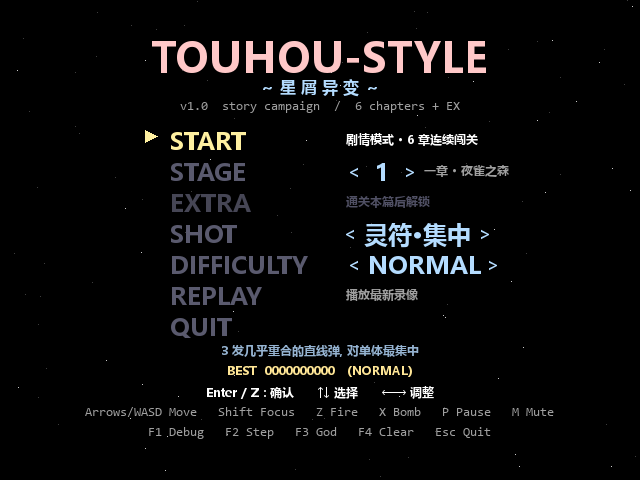
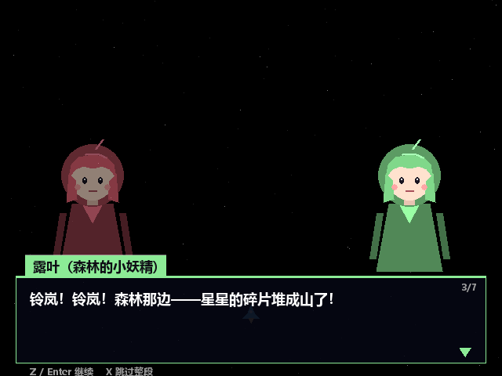
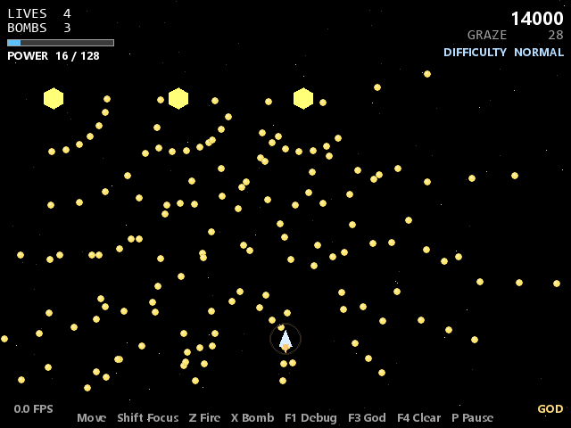
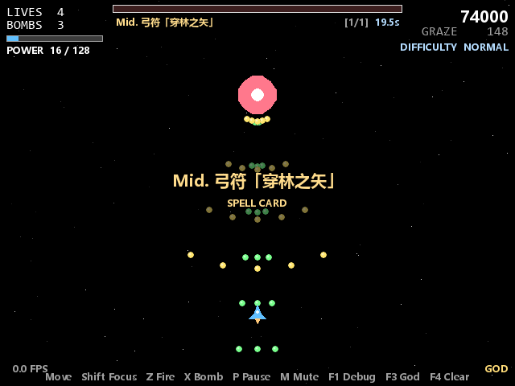
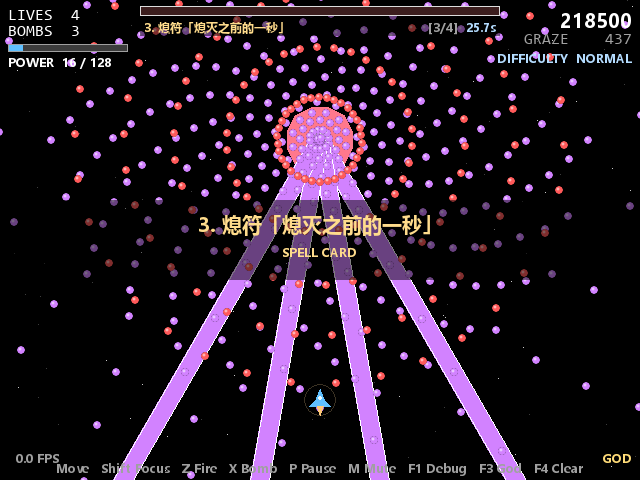
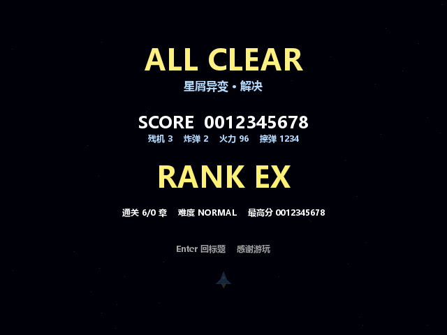
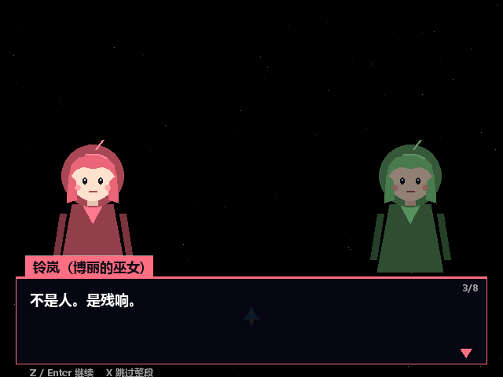

# Touhou-style Vertical STG — 星屑异变 (v1.0)

类东方风格的纵版弹幕射击游戏，Python + pygame-ce 实现。

v1.0 在原有弹幕引擎之上补了**剧情模式**：六章连续闯关，章首、Boss 登场、章末都有对话，
残机 / 炸弹 / 火力 / 分数跨章继承，最后有 ALL CLEAR 结算与最高分存档。



| 剧情对话 | 道中弹幕 |
| --- | --- |
|  |  |
| **Boss 符卡** | **符卡激光** |
|  |  |
| **ALL CLEAR** | **EX 章** |
|  |  |

## 运行

```powershell
pip install -r requirements.txt
python main.py
```

只有 `pygame-ce` 是运行必需依赖（`numpy` 是可选的，当前代码不 import 它）。

## 玩法

标题菜单（↑↓ 选择，←→ 调整，Enter / Z 确认）:

| 行 | 说明 |
| --- | --- |
| START | 剧情模式：六章连续闯关，中途不退出 |
| STAGE | 单关练习：0 教学关 / 1~7 剧情章与 EX 章 / 8~10 追加 EX 关 |
| EXTRA | EX 章「星之残响」：本篇全通一次后解锁 |
| SHOT | 自机符卡类型：灵符·集中 / 散符·扩散 / 追尾·诱导 |
| DIFFICULTY | EASY / NORMAL / HARD / LUNATIC |
| REPLAY | 播放 `replay/` 里最新的一份录像 |
| QUIT | 退出 |

三种符卡类型的区别在**弹道**而不是数值（单次齐射都是 3 发 × 1 伤害，
所以 DPS 上限一致，平衡检查的结论对三种都成立）：

| 类型 | 弹道 | 适合 |
| --- | --- | --- |
| 灵符·集中 | 3 发几乎重合的直线弹 | 单体输出、卡位对轴 |
| 散符·扩散 | 3 发扇形，张角 0.44 rad | 清群、同时压制多目标 |
| 追尾·诱导 | 3 发会拐弯的追踪弹（7 rad/s，1.2s） | 命中率最高，弹速偏慢 |

游戏中按键:

- 方向键 / WASD：8 向移动
- Shift：低速（聚焦）— 显示判定点
- Z：射击（按住连续发射）
- X：炸弹（清屏 + 无敌 2s + 计分）
- P：暂停 / 恢复
- Esc：退出
- R：Game Over 后整局重来；暂停时按 R 只重开当前这一关/一章
- M：静音开关（HUD 右下角会显示 `MUTE`）
- F1 调试 overlay / F2 帧步进 / F3 无敌 / F4 清屏

剧情对话中：Z / Enter 继续（未打完则立刻打完），X 跳过整段。

## 剧情：星屑异变

夜空中的星星在以肉眼可见的速度变少。博丽的巫女铃岚和森林妖精露叶一路向上，
最后发现是一台「收集愿望、以星光为燃料」的装置在抽取整片夜空。

| 章 | 关卡 | 对手 | 一句话 |
| --- | --- | --- | --- |
| 一章 | 夜雀之森 | 小夜（夜雀） | 碎星不是掉下来的，是往上飞的 |
| 二章 | 雾湖冰晶 | 冰华（冰之妖精） | 有人在把星星冻进湖里 |
| 三章 | 迷途竹林 | 铃月（守路人） | 竹林后面，是通到天上的路 |
| 四章 | 星之书库 | 紫书（记录者） | 星之器是照着我的书造的 |
| 五章 | 机关天守 | 机织 零（机关人偶） | 三百六十一年，一直在数星星 |
| 终章 | 星之器 | 穹（守护者） | 愿望需要燃料，夜空就是燃料 |
| EX | 星之残响 | 残响（装置的残渣） | 等最后一个愿望，然后真的熄灭 |

EX 章是本篇全通一次后解锁的追加章：只有一章、没有结局，打完直接 `EX CLEAR` 结算。
它的弹幕密度和符卡数（2 + 4 张）是全线最高的。

| EX 章剧情 |
| --- |
|  |

剧情数据全部在 [`assets/story/campaign.json`](assets/story/campaign.json)：
角色名 / 立绘颜色 / 站位、每章的前置对话（prologue）、Boss 登场对话（boss_intro）、
章末对话（clear）、以及结局（ending）。**改台词不需要动代码**。

```json
{
  "rein": { "name": "铃岚", "title": "博丽的巫女",
            "color": [255, 110, 130], "side": "left" },
  "chapters": [
    { "id": 1, "stage_id": 1, "title": "一章", "subtitle": "褪色的夜空",
      "prologue":  [{ "speaker": "rein", "text": "……星星在掉。" },
                    { "text": "（省略 speaker 即为旁白）" }],
      "boss_intro": [ ... ],
      "clear":     [ ... ] }
  ],
  "ending": [ ... ]
}
```

立绘没有美术资源，是 [`src/ui/dialoguebox.py`](src/ui/dialoguebox.py) 里用几何图形
按角色颜色程序化画出来的 Q 版人形——改颜色就能换人设。

## 关卡数据

七个剧情关卡（六章 + EX 章）在 `assets/stages/ch1.json ~ ch7.json`，由
[`tools/gen_stages.py`](tools/gen_stages.py) 生成：

```powershell
python tools/gen_stages.py           # 重新生成 ch1..ch7
python tools/gen_stages.py --check   # 只校验，不写文件
```

因为同构编队（横穿妖精、悬停环弹机、分裂弹机……）很多，用脚本描述比手写 JSON 好维护，
调平衡只改这个文件里的数值。每章的 JSON 仍可直接手改，但下次生成会被覆盖。

关卡支持的弹幕模式：`aimed / fan / ring / spiral / scatter / delayed_aimed /
delayed_fan / delayed_ring`，角度可写成 `"PI"`, `"PI/3"`, `"2*PI"` 这类字符串。
符卡还可以带 `lasers` 数组（激光弹幕），例如：

```json
"lasers": [
  {"period": 2.2, "start_t": 1.0, "count": 4, "arc": "PI/3",
   "angle": "aimed", "width": 18, "warning": 0.8, "active": 1.2}
]
```

`angle` 可以是 `"aimed"` 或弧度字符串；`count > 1` 时按 `arc` 张开。
激光走的是独立的 `LaserPool`，有预警 → 实弹 → 淡出三段状态。
数据结构见 [`src/stages/loader.py`](src/stages/loader.py) 顶部说明。

## 目录结构

```
game/
├── main.py                   入口
├── config.py                 全局数值 / 颜色 / 难度曲线
├── assets/
│   ├── stages/               关卡 JSON (ch1..ch7 = 剧情六章 + EX 章, stage*.json = 教学/旧 EX)
│   └── story/campaign.json   剧情脚本 + 角色定义
├── docs/screenshots/         无头截图 (README 用)
├── replay/                   录像输出 (自动生成, 已 gitignore)
├── save/records.json         最高分 / 通关次数 (自动生成, 已 gitignore)
├── src/
│   ├── core/
│   │   ├── game.py           主循环 + 场景/章节状态机
│   │   ├── input_manager.py  输入 + 缓冲 + Replay 注入
│   │   ├── save_data.py      最高分存档 (读写失败静默降级)
│   │   ├── audio.py          程序化音效 (代码合成 PCM, 无需音频文件)
│   │   ├── assets.py / replay.py / rng.py
│   ├── entities/             自机 / 敌机 / Boss / 子弹池 / 激光 / 道具 / 粒子
│   ├── patterns/             8 种弹幕模式 + 符卡数据
│   ├── stages/               JSON loader / stage_factory / stage1(兼容)
│   ├── story/                剧情数据模型 + 对话状态机
│   └── ui/                   hud / menu / dialoguebox / fonts / overlay
└── tools/
    ├── check_ast.py          静态检查 (语法 + import 链 + JSON)
    ├── smoke_test.py         模块级冒烟测试 (真 pygame, dummy 驱动)
    ├── story_smoke.py        剧情模式端到端测试 (六章跑通到 ALL CLEAR + EX)
    ├── balance_check.py      符卡可击破性检查 (需求伤害 vs 时限内理论伤害)
    ├── capture_shots.py      无头截图
    ├── gen_stages.py         生成七章关卡数据
    └── build.bat / build.sh  PyInstaller 打包
```

## 测试

全部无头运行，不需要显示器：

```powershell
python tools\check_ast.py      # 静态检查：语法 / import 链 / JSON 合法性
python tools\smoke_test.py     # 模块冒烟：对象池、弹幕模式、Replay、UI
python tools\story_smoke.py    # 端到端：六章连续闯关 + EX 章 + 压力测试
python tools\balance_check.py  # 符卡可击破性：需求伤害 vs 时限内理论伤害
```

`story_smoke.py` 会真的跑完整流程：自动跳过所有对话、秒杀每个 Boss，
检查章节顺序、分数继承、存档写入、暂停「重开本章」的语义、EX 章解锁条件、
三种射击流派都能开火、追踪弹真的会拐弯、符卡激光的预警/实弹阶段，
最后渲染 ALL CLEAR / EX CLEAR 画面；末尾还会用 LUNATIC 在 EX 关满密度跑 100 秒，
确认弹幕数量不会失控（当前峰值约 2000 颗）。

它把存档重定向到临时目录，不会污染 `save/records.json`。

三个脚本的退出码都是 `0` 通过 / `1` 失败，可直接接 CI。

`balance_check.py` 是设计期的护栏：按玩家理论 DPS（满火力 3 发 / 0.08s = 37.5）
逐张算符卡「需要打掉的伤害 / 时限内能打出的伤害」。比值 > 1 的符卡玩家永远只能
超时，拿不到 bonus——这种错误游戏不会报错，手测也很难发现。当前 39 张符卡全部可击破，
最紧的是终章 Final（0.83）。

## 打包

```powershell
tools\build.bat        # Windows -> dist/TouhouSTG.exe
bash tools/build.sh    # Linux / macOS
```

依赖 `pip install pyinstaller`。`TouhouSTG.spec` 现在用相对路径打包
`assets/`（原来的绝对路径 `D:/myfirstgame/assets` 换目录就失效）。

## 数值约定 (config.py)

- 屏幕 640×480，y 向下，左上为 (0, 0)
- 角度：弧度，0 = +x
- 速度：px/s；时间：物理秒
- `BULLET_SPEED_GLOBAL_SCALE` 统一压慢敌弹，改一个数即可整体调难度

## 已知限制

- 立绘是程序化几何图形，不是美术资源
- 没有 BGM：音效是代码合成的（`src/core/audio.py`），没有音频文件；`assets/sfx/` 里放 `.ogg` 会被 `AssetLoader` 优先使用
- Replay 只记录**单关**输入；剧情模式每章单独录一份，不能整局回放
- Replay 依赖 RNG seed 重放：改了关卡 JSON 后旧录像会对不上
- LUNATIC 高密度弹幕的帧率取决于机器

## 音效

没有音频资源，全部在 `src/core/audio.py` 里用「正弦扫频 + 指数包络」合成，
带白噪的爆炸类走一阶低通。11 种音效：射击 / 命中 / 击破 / 擦弹 / 炸弹 / 死亡 /
符卡宣言 / 菜单移动 / 菜单确认 / 过关 / 警告。

- 采样参数跟随 `pygame.mixer.get_init()`（通常 44100Hz / 16bit / 单声道），
  `array('h')` 裸缓冲直接塞进 `pygame.mixer.Sound(buffer=...)`
- 同类音效有最小间隔（射击 0.075s 一次），避免混音器被打满
- 混音器不可用（无声卡 / 服务端）时整体降级为 no-op，不影响游戏
- `M` 键静音

## 版本与回滚

- 本版为 **v1.0**，对应 tag `v0.6-baseline` 的上游版本是改造前的快照
- 回退到改造前：

  ```powershell
  git fetch --tags
  git reset --hard v0.6-baseline
  ```

- 只想看旧版：`git worktree add ../TouhouSTG-v0.6 v0.6-baseline`
- 单次提交出问题：`git revert <commit>`，历史保持线性，没有强推

## 变更点 (v0.6 -> v1.0)

- **剧情模式**：6 章连续闯关，章首 / Boss 登场 / 章末对话，结局与 ALL CLEAR
- **EX 章**：本篇全通一次后解锁「星之残响」，弹幕密度与符卡数全线最高，打完是 EX CLEAR
- **章节继承**：残机 / 炸弹 / 火力 / 分数 / 擦弹跨章保留（原先打完一关就回菜单）
- **关卡**：新增七章主线和 8 种编队模式，Boss 符卡从 2~3 张提升到 3~6 张
- **存档**：`save/records.json` 记录各难度最高分与全通次数，标题画面显示 BEST
- **音效**：11 种程序化音效（代码合成，无音频文件），M 键静音
- **自机符卡**：3 种射击流派（集中 / 扩散 / 追尾），弹道不同而非纯数值堆叠
- **激光符卡**：`LaserPool` 之前一直没被关卡用过；现在符卡可以配 `lasers`，
  竹林 / 天守 / 终章 / EX 章的四张符卡用上了激光
- **打击感**：Boss 击破与放炸弹时有短暂定格；击破瞬间清掉残留敌弹
  （原先会在「赢了」的那一秒被旧弹打死）
- **平衡护栏**：`tools/balance_check.py` 按理论 DPS 检查每张符卡能否在时限内打破
  （曾检出 EX 章终符需求 1210 伤害、时限内只有 1200，已调整）
- **修 bug**：
  - `pygame.font.SysFont` 在部分 Windows 机器上直接抛 `TypeError`，游戏起不来 —— 改为直接指定字体文件，并接入中文字体
  - pygame-ce 2.6.1 下小半径圆形被光栅化成「十字/齿轮」，弹幕看起来像小星星 —— 改为 4 倍超采样
  - 自机机身颜色恒为白色（`bomb_time=0` 时取错分支）
  - 教学关提示被重复绘制两次；`_tutorial_hints` 每帧重建
  - 菜单关卡上限与 `STAGE_FILE_MAP` 差一位，教学关与 EX 关选不到
  - 剧情模式暂停里写「R 重开本关」但实际重开整局 —— 现在真的只重开当前章
  - `check_ast.py` 不认 `from package import submodule`，误报
